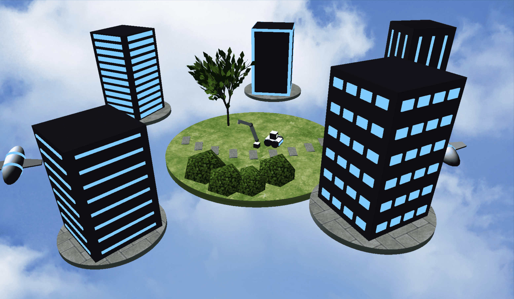

# Future City

An interactive 3D cityscape built in C++ with OpenGL and FreeGLUT for CPT205 coursework. The scene includes an L-system tree, an articulated watering arm with water particles, a wheeled robot, and aircraft following centripetal Catmull–Rom flight paths.

## Build and run

The current source targets Windows/MSVC and uses OpenGL's fixed-function pipeline.

1. Install a C++ compiler and FreeGLUT development libraries.
2. Add `FutureCity/source.cpp` to a C++ project. Configure the FreeGLUT include and library paths, then link against static FreeGLUT, OpenGL, and GLU. The source defines `FREEGLUT_STATIC`.
3. Build and run with `FutureCity/` as the working directory so that `texture/*.bmp` can be loaded. Alternatively, copy the `texture/` folder beside the executable and run from that directory.

## Controls

| Input | Action |
| --- | --- |
| `W` / `S` | Move the robot forward / backward |
| `A` / `D` | Turn the robot left / right |
| `C` | Switch between global and robot camera views |
| `1` / `2` | Adjust the lower arm angle |
| `3` / `4` | Adjust the upper arm angle |
| `5` / `6` | Rotate the arm base in opposite directions |
| Hold `P` | Spray water |
| `N` | Toggle day / night |
| `+` / `-` | Increase / decrease robot headlight brightness |
| `K` | Cycle emissive colors |
| `T` | Show / hide aircraft paths |
| `I` | Show / hide the control guide |
| Left mouse drag | Rotate the global camera |
| Scroll wheel | Zoom the global camera |
| Right-click | Open the scene settings menu |

## Acknowledgements

The L-system tree implementation draws on [yaBorn's Fractal_tree_of_L-System](https://github.com/yaBorn/Fractal_tree_of_L-System).
